# Zenpi Execution Blueprint v2 — Gantt (generated, read-only)

> Generated by `tools/generate_blueprint_v2_gantt.py`. Do not edit; the
> authoritative checklist is the Blueprint itself.

```yaml
source: Docs/Zenpi_Execution_Blueprint_v2.md
source_sha256: 692b096a71cc2b0202da50a9f6f4a8cd9ac0ce37e7510c0065f3dda106c1c617
blueprint_version: 4.0.0
generated_at: 2026-10-14T23:20:32Z
```

## Dependency-order view

Bars are relative one-unit slots ordered by `Depends`; they are not dates.

```mermaid
gantt
    dateFormat X
    axisFormat %d
    section A0
    ZE-001 Agent loop、steer/follow-up 持久队列、有界工具批次、d :done, ZE_001, 0, 1d
    ZE-002 append-only JSONL session、分支树、fork、 /new :done, ZE_002, 0, 1d
    ZE-003 版本化语义 checkpoint 与真实 backend 摘要（已知缺陷：ZE- :done, ZE_003, 0, 1d
    ZE-004 Provider 层：模型 registry 与能力协商、Responses/C :done, ZE_004, 0, 1d
    ZE-005 认证：Codex 浏览器/设备 OAuth、刷新、凭据存储、API key 解析 :done, ZE_005, 0, 1d
    ZE-006 内置工具 read/list/search/find/write/edit/ru :done, ZE_006, 0, 1d
    ZE-007 审批协调器、写前 diff 预览、批准后摘要重校验、审计回执 :done, ZE_007, 0, 1d
    ZE-008 SKILL.md 发现与按需加载、参数模板、资源原子 reload（已知缺陷：Z :done, ZE_008, 0, 1d
    ZE-009 类型化 subprocess hooks 与生命周期撤销 :done, ZE_009, 0, 1d
    ZE-010 Headless stdio JSONL v2：有界帧、请求 ID 幂等、rec :done, ZE_010, 0, 1d
    ZE-011 TUI 输入：多行编辑、历史、粘贴折叠与粘贴突发识别、排队消息编辑、kill/y :done, ZE_011, 0, 1d
    ZE-012 TUI 渲染：滚动复制、退出与信号时恢复终端、Codex 交互矩阵、热区模型、按 :done, ZE_012, 0, 1d
    ZE-013 项目 workspace 与 worktree 双排标签、目录选择器、SSH 工 :done, ZE_013, 0, 1d
    ZE-014 内嵌 PTY Shell 面板、VT 字符网格、IME 热区（§6.1 冻结，已 :done, ZE_014, 0, 1d
    ZE-015 运行时面板：Conversation/Arch 两个独立 session 与两个 :done, ZE_015, 0, 1d
    ZE-016 b3ehive 领域：Blueprint/Goal/Learn 记录、 /exe :done, ZE_016, 0, 1d
    ZE-017 Resources 资源总线、局域网感知、LAN headless 集群（§6. :done, ZE_017, 0, 1d
    ZE-018 生产入口与单进程 footprint 预算 :done, ZE_018, 0, 1d
    ZE-019 DAG 编排最小集：类型化关系、claim/ack 邮箱与重投、worker 心 :done, ZE_019, 0, 1d
    ZE-020 Exa  websearch  工具（没有对应的 ZS1 项，按已合入 main :done, ZE_020, 0, 1d
    section A1
    ZE-100 权威切换： Docs/execution/active_requirement. :done, ZE_100, after ZE_101 ZE_102, 1d
    ZE-101 重写  tools/validate_blueprint_v2.py ：解析 c :done, ZE_101, 0, 1d
    ZE-102 同名只读 Gantt： tools/generate_blueprint_v2_ :done, ZE_102, after ZE_101, 1d
    ZE-104 共享的脚本化 provider：同一份脚本同时驱动进程内的  ScriptedB :done, ZE_104, 0, 1d
    ZE-105 Provider 录制回放套件：把  Docs/quality/stage1/p :done, ZE_105, after ZE_104, 1d
    ZE-106 TUI 生产 loop 的测试注入点：让  run_async_with_rem :done, ZE_106, after ZE_104, 1d
    ZE-107 验收工作区里已经实现但没有勾选的 ZS1-180（ --auto ）、ZS1-1 :done, ZE_107, 0, 1d
    ZE-108 CI 绿基线与 Rust 规范门（来源：codex-rust-deslop、ze :done, ZE_108, after ZE_100, 1d
    ZE-109 执行协议机械化（来源：b3ehive bridge contract）。内容如下 :done, ZE_109, after ZE_101 ZE_102, 1d
    section A2
    ZE-213 给模型的工具结果改为纯文本（对齐 pi 的 content 与 details :done, ZE_213, after ZE_104, 1d
    ZE-200 子进程继承用户环境：保留  PATH / HOME / USER / SHELL :done, ZE_200, after ZE_104, 1d
    ZE-201 run_command  对齐 pi：<br>• stdout 和 stder :done, ZE_201, after ZE_213, 1d
    ZE-202 工具超时或 IO 失败时作为错误结果回给模型，不再映射为  UnknownOut :done, ZE_202, after ZE_201, 1d
    ZE-203 read_file  按行用  offset / limit  分页（每页 2 :done, ZE_203, after ZE_213, 1d
    ZE-204 写/编辑的单次调用上限与  MAX_WRITE_BYTES  对齐 工具参数超限 :done, ZE_204, after ZE_104, 1d
    ZE-205 edit 规范化：剥离 BOM 按 LF 规范化后匹配，并恢复原来的行尾 采用 :done, ZE_205, after ZE_104, 1d
    ZE-206 接受工作区内的绝对路径，以及  ~ 、前导  @  写法 越界路径仍然拒绝 :done, ZE_206, after ZE_104, 1d
    ZE-207 搜索改为单次  rg --json ：默认按 regex 匹配，需要时用  -- :done, ZE_207, after ZE_213, 1d
    ZE-214 默认工具集与  --tools  白名单： dag_*  只对 DAG 派生的 :done, ZE_214, 0, 1d
    ZE-210 工具调用之后，模型回复空文本或只有 reasoning 时，本轮正常结束。协议层 :done, ZE_210, after ZE_104, 1d
    ZE-211 输入队列的记录数和字节数只统计未结束的输入  recover()  不再每次都重 :done, ZE_211, 0, 1d
    ZE-212 只给  run_active_turn_cancelable  的事件缓冲设上限 :done, ZE_212, 0, 1d
    ZE-220 保留有界（4 KB）的错误响应体 新增  BackendError  Conte :done, ZE_220, after ZE_105, 1d
    ZE-221 Completion  增加  StopReason{Stop Length :done, ZE_221, after ZE_105, 1d
    ZE-222 把实际在用的 Codex、OpenAI、Claude、Gemini 模型编进目录 :done, ZE_222, after ZE_105, 1d
    ZE-223 接受别名解析后服务端返回的模型 ID（记录下来，不拒绝） 旧 Anthropic :done, ZE_223, after ZE_105, 1d
    ZE-224 Chat dialect 发送  reasoning_effort :done, ZE_224, after ZE_105 ZE_222, 1d
    ZE-225 缓存与用量：Anthropic 在 system 和最后一个用户块上加  cac :done, ZE_225, after ZE_105, 1d
    ZE-226 放宽脆弱的校验：<br>• Chat：允许 stop 与工具调用同时出现，允许缺 :done, ZE_226, after ZE_105, 1d
    ZE-227 跨模型历史转换：目标模型或 wire 与某轮的  native_history :done, ZE_227, after ZE_105, 1d
    ZE-230 基础 system prompt。内容如下：<br>• 工具清单与使用准则，写明 :done, ZE_230, after ZE_104, 1d
    ZE-231 撕裂的末尾可以恢复：<br>• 可写打开时，把没有换行的末行复制为  .torn :done, ZE_231, after ZE_104, 1d
    ZE-232 compaction 对齐 pi（对应 learn： compaction.ts :done, ZE_232, after ZE_220 ZE_225 ZE_104, 1d
    ZE-233 模板和技能展开后的文本写进用户 turn 技能正文移出 system promp :done, ZE_233, after ZE_230, 1d
    ZE-234 **（最先修：目前会导致无法启动）** 单个无效的 SKILL.md、模板或 :done, ZE_234, 0, 1d
    ZE-235 删除没有生产调用方的旧 compaction（ prepare_context :done, ZE_235, after ZE_232, 1d
    ZE-236 session 默认行为对齐 pi（对应 learn： session-mana :done, ZE_236, after ZE_231, 1d
    ZE-240 异步生产 host 在 prompt 入队时就判定  mode  和  expe :done, ZE_240, after ZE_104, 1d
    ZE-241 事件按因果顺序输出：每个 job 一个按序号排序的单一邮箱，取代"准入、增量、工 :done, ZE_241, after ZE_104, 1d
    ZE-242 生命周期：<br>• SIGTERM 等同于  shutdown  <br>• :done, ZE_242, after ZE_104, 1d
    ZE-243 删除二进制不使用的同步  run_headless / run_stdio  及 :done, ZE_243, after ZE_240, 1d
    ZE-250 修复 text→tool→text 的顺序：工具开始时结束当前流式段，结束时只收 :done, ZE_250, after ZE_106, 1d
    ZE-251 审批的过期清扫覆盖后台标签页 中断只作用于当前 job 所属的 owner 取消 :done, ZE_251, after ZE_106, 1d
    ZE-252 双击 Ctrl-C 的计数只在同一热区内累计（跨热区的两次不构成双击） 同一热区 :done, ZE_252, after ZE_106, 1d
    ZE-253 COMMAND_SPECS  作为唯一的命令目录：补齐  /reasoning :done, ZE_253, 0, 1d
    ZE-254 删除旧的同步 TUI 路径（ run 、 run_interactive 、 r :done, ZE_254, after ZE_106, 1d
    ZE-255 panic 时恢复终端： TerminalGuard  enter  安装一个串 :done, ZE_255, 0, 1d
    ZE-260 DAG 正确性：<br>• worker 默认用  current_exe() :done, ZE_260, 0, 1d
    section A3
    ZE-300 headless 去轮询（对应 redis ae：睡到下一个真实截止时间）：<b :done, ZE_300, after ZE_243, 1d
    ZE-301 传输层：进程内共享一个  ureq  Agent （keep-alive 连接池 :done, ZE_301, after ZE_105, 1d
    ZE-302 工具、搜索、扩展的读取改用  poll(2)  阻塞等待：单个线程同时监听两个 :done, ZE_302, after ZE_201 ZE_207, 1d
    ZE-303 reconnect WAL 收敛（对应 redis aof：只对确认点做持久化， :done, ZE_303, after ZE_243, 1d
    ZE-304 session 日志的 fsync 策略：只对 turn、 operation_ :done, ZE_304, after ZE_231, 1d
    ZE-305 session 内存瘦身（实测：1 万条混合记录常驻 6.5× 文件大小）：<b :done, ZE_305, after ZE_232, 1d
    ZE-306 session 目录每个日志只解析一次（catalog 与搜索不再先 inspe :done, ZE_306, after ZE_236, 1d
    ZE-307 凭据元数据缓存：领取前先用计数器核实问题确实存在。实测（release，2000 :done, ZE_307, 0, 1d
    ZE-308 DAG 存储降本（实测后按奥卡姆裁剪，不拆文件）：<br>• 原实现每个等待者每 :done, ZE_308, after ZE_260, 1d
    ZE-309 TUI 渲染成本：按消息缓存已渲染的行，只让正在流式输出的那条失效 项目 che :done, ZE_309, after ZE_106, 1d
    section A4
    ZE-400 进程内 golden 任务套件（使用真实工具、临时工作区）。覆盖以下场景：<br :done, ZE_400, after ZE_202 ZE_203 ZE_205 ZE_210 ZE_213 ZE_221 ZE_227 ZE_232, 1d
    ZE-401 二进制级 headless 任务：针对 ZE-104 的假服务器启动  zenp :done, ZE_401, after ZE_400 ZE_236 ZE_240 ZE_242 ZE_303, 1d
    ZE-402 TUI 任务快照，覆盖以下用例：<br>• text→tool→text <br :done, ZE_402, after ZE_250 ZE_251 ZE_252 ZE_254 ZE_255, 1d
    ZE-403 2000 agent 压测  tools/load_agents.py ：<br :done, ZE_403, after ZE_236 ZE_300 ZE_301 ZE_302 ZE_303 ZE_304 ZE_305 ZE_401, 1d
    ZE-404 CI 门禁：每个 PR 运行 G-RUST、G-TASK 和  G-LOAD(2 :active, ZE_404, after ZE_108 ZE_400 ZE_401 ZE_402 ZE_403, 1d
    ZE-406 文档收口：<br>• README 和  Docs/Zenpi_Executio :ZE_406, after ZE_100 ZE_404, 1d
    ZE-999 Master 终验：A、B 两块 全部为  [x]  G-BUILD、G-TES :ZE_999, after ZE_400 ZE_401 ZE_402 ZE_403 ZE_404 ZE_406 ZE_599, 1d
    section B1
    ZE-500 代码入库与 CI 基线：<br>• 提交  android/ 、 src/rem :done, ZE_500, after ZE_100 ZE_108, 1d
    ZE-502 接受已有的核心成果：<br>• 主机侧：线协议（frame、envelope v :done, ZE_502, after ZE_500, 1d
    section B2
    ZE-510 把远程状态（回执、ack、intent）从  project-workspace :done, ZE_510, after ZE_502, 1d
    ZE-511 把 worktree、worker、subtab 子系统从  src/remot :done, ZE_511, after ZE_510, 1d
    ZE-512 远程宿主去轮询（实测后按奥卡姆裁剪）：owner 线程不再每 10 ms 无条件 :done, ZE_512, after ZE_243 ZE_502, 1d
    ZE-513 常驻的  zenpi host serve ：<br>• 监听器的生命周期与邀请 :done, ZE_513, after ZE_502, 1d
    ZE-514 配对后即可使用：<br>• 桌面确认后，授予所挂载项目的 Control 和 A :done, ZE_514, after ZE_513, 1d
    ZE-515 基于密钥的身份与二维码 v2：<br>•  host_id = sha256(S :done, ZE_515, after ZE_514, 1d
    ZE-516 网络 T1 叠加网：<br>• 主机端  --tailnet  按网卡地址识别 :done, ZE_516, after ZE_515, 1d
    ZE-517 流式对齐：把  live_text  目前 4 KiB 的整行预览改为逐 tok :done, ZE_517, after ZE_502, 1d
    ZE-518 拆分 Android UI：<br>• 把  PairingScreen （约 :done, ZE_518, after ZE_502, 1d
    ZE-519 竖屏截图测试底座：Roborazzi，分辨率 360×800 和 412×915 :done, ZE_519, after ZE_518, 1d
    ZE-530 对话主屏：<br>• 用 reverse 的  LazyColumn ，自动贴底 :done, ZE_530, after ZE_519 ZE_517, 1d
    ZE-531 审批：常驻审批条加底部面板。面板显示 i/N 和彩色补丁，点一次即决定，有待决审 :done, ZE_531, after ZE_530, 1d
    ZE-532 抽屉收件箱：会话和项目按"需要你 / 运行中 / 空闲"分组，角标等于待审批数 :done, ZE_532, after ZE_518, 1d
    ZE-533 次级页与路由栈：<br>• Sessions：搜索和恢复 <br>• Diff： :done, ZE_533, after ZE_530, 1d
    ZE-534 输入框命令板：输入  /  时弹出底部面板，列出主机端的斜杠命令和资源 输入 :done, ZE_534, after ZE_530 ZE_253, 1d
    ZE-535 安全与无障碍：<br>• 默认开启  FLAG_SECURE  <br>• 支持 :ZE_535, after ZE_533, 1d
    section B3
    ZE-520 remote  feature 开关（默认关闭）：<br>•  cfg  覆盖 :active, ZE_520, after ZE_510 ZE_511 ZE_108, 1d
    ZE-541 监听器加固：<br>• accept 改为事件驱动，不再每 10 ms 轮询 < :ZE_541, after ZE_513, 1d
    ZE-542 持久认证连接：订阅复用同一条 TLS 会话，空闲时每分钟握手不超过 1 次 订阅 :ZE_542, after ZE_541 ZE_512, 1d
    ZE-543 设备注册表按 mtime 缓存，不再在每一帧都 flock 并解析一遍 撤销仍在 :ZE_543, after ZE_514, 1d
    ZE-544 后台审批通知：<br>• 申请  POST_NOTIFICATIONS  权限 :ZE_544, after ZE_531 ZE_542, 1d
    section B4
    ZE-590 生产端到端测试： zenpi host serve  配合 ZE-104 的脚本 :ZE_590, after ZE_104 ZE_514 ZE_517 ZE_542, 1d
    ZE-591 Android 体验验收，覆盖以下必做要求：<br>• 审批通知在 2 s 内送 :ZE_591, after ZE_530 ZE_531 ZE_532 ZE_533 ZE_534 ZE_535 ZE_544, 1d
    ZE-592 真机验收：<br>• 一台 API 35 模拟器 <br>• 一台实体手机连实体 :ZE_592, after ZE_590 ZE_591 ZE_516, 1d
    ZE-593 发布：<br>• 签名的 sideload APK， apksigner ver :ZE_593, after ZE_592, 1d
    ZE-599 B 块终验：B1–B4 全部  [x] ，G-REMOTE、G-ANDROID、 :ZE_599, after ZE_590 ZE_591 ZE_592 ZE_593, 1d
```



## Monitoring index

Counts: open 12 · self-tested 2 · accepted 99 · total 113

| ID | Layer | State | Ready | Depends | Claim | Integration | Est. LOC | Title |
|---|---|---|---|---|---|---|---:|---|
| ZE-001 | A0 | accepted | no | — | — | accepted | 0 | Agent loop、steer/follow-up 持久队列、有界工具批次、doom-loop 防护（已知缺陷：ZE-202、ZE-210、ZE-211） |
| ZE-002 | A0 | accepted | no | — | — | accepted | 0 | append-only JSONL session、分支树、fork、`/new`、session 命名与 `-s` 恢复（已知缺陷：ZE-231、ZE-236） |
| ZE-003 | A0 | accepted | no | — | — | accepted | 0 | 版本化语义 checkpoint 与真实 backend 摘要（已知缺陷：ZE-232） |
| ZE-004 | A0 | accepted | no | — | — | accepted | 0 | Provider 层：模型 registry 与能力协商、Responses/Chat SSE、Anthropic 与 Gemini 原生 adapter、第三方供应商开放、模型生命周期状态（已知缺陷：ZE-220..227） |
| ZE-005 | A0 | accepted | no | — | — | accepted | 0 | 认证：Codex 浏览器/设备 OAuth、刷新、凭据存储、API key 解析（首启登录引导 PA10 仍是 partial，按 §6.1 冻结；未接线的入口由 ZE-108 清理） |
| ZE-006 | A0 | accepted | no | — | — | accepted | 0 | 内置工具 read/list/search/find/write/edit/run_command，输出 artifact、流式脱敏、ripgrep 搜索（已知缺陷：ZE-200..207、ZE-213、ZE-214） |
| ZE-007 | A0 | accepted | no | — | — | accepted | 0 | 审批协调器、写前 diff 预览、批准后摘要重校验、审计回执 |
| ZE-008 | A0 | accepted | no | — | — | accepted | 0 | SKILL.md 发现与按需加载、参数模板、资源原子 reload（已知缺陷：ZE-233、ZE-234） |
| ZE-009 | A0 | accepted | no | — | — | accepted | 0 | 类型化 subprocess hooks 与生命周期撤销 |
| ZE-010 | A0 | accepted | no | — | — | accepted | 0 | Headless stdio JSONL v2：有界帧、请求 ID 幂等、reconnect、与 TUI 共享项目上下文（已知缺陷：ZE-240..243、ZE-303） |
| ZE-011 | A0 | accepted | no | — | — | accepted | 0 | TUI 输入：多行编辑、历史、粘贴折叠与粘贴突发识别、排队消息编辑、kill/yank、外部编辑器、命令/文件补全与模型选择 |
| ZE-012 | A0 | accepted | no | — | — | accepted | 0 | TUI 渲染：滚动复制、退出与信号时恢复终端、Codex 交互矩阵、热区模型、按热区的 Ctrl-C 语义（已知缺陷：ZE-250..255） |
| ZE-013 | A0 | accepted | no | — | — | accepted | 0 | 项目 workspace 与 worktree 双排标签、目录选择器、SSH 工作目录、持久化（§6.1 冻结） |
| ZE-014 | A0 | accepted | no | — | — | accepted | 0 | 内嵌 PTY Shell 面板、VT 字符网格、IME 热区（§6.1 冻结，已知缺陷记在 §6.1） |
| ZE-015 | A0 | accepted | no | — | — | accepted | 0 | 运行时面板：Conversation/Arch 两个独立 session 与两个 prompt、Gantt 面板、信息头（§6.1 冻结） |
| ZE-016 | A0 | accepted | no | — | — | accepted | 0 | b3ehive 领域：Blueprint/Goal/Learn 记录、`/execute` `/sync` `/explore` `/addloop`、可验证外部结果（§6.1 冻结） |
| ZE-017 | A0 | accepted | no | — | — | accepted | 0 | Resources 资源总线、局域网感知、LAN headless 集群（§6.1 冻结） |
| ZE-018 | A0 | accepted | no | — | — | accepted | 0 | 生产入口与单进程 footprint 预算 |
| ZE-019 | A0 | accepted | no | — | — | accepted | 0 | DAG 编排最小集：类型化关系、claim/ack 邮箱与重投、worker 心跳、`dag_*` 工具（已知缺陷：ZE-260、ZE-308） |
| ZE-020 | A0 | accepted | no | — | — | accepted | 0 | Exa `websearch` 工具（没有对应的 ZS1 项，按已合入 main 的 commit e8733e6 记入基线） |
| ZE-100 | A1 | accepted | no | ZE-101, ZE-102 | ZE-100@blueprint-4.0.0 | accepted | 90 | 权威切换：`Docs/execution/active_requirement.json` 指向本文件，旧的 Stage 1 选择器归档到 `Docs/execution/archive/`；v1、Stage 1、Stage 2 文件头改为 `authoritative: false` 并写入 `superseded_by`；停用 Stage 2 selector；`/sync` 改为优先读取激活的选择器，扫描时跳过 `_Gantt` 投影，并按目标 blueprint 的 `stable_id_pattern` 生成新 ID；CI 改为运行本文件的校验器和 Gantt 检查 |
| ZE-101 | A1 | accepted | no | — | ZE-101@blueprint-4.0.0 | accepted | 260 | 重写 `tools/validate_blueprint_v2.py`：解析 checkbox 行，拒绝重复 ID、缺失或未知依赖、依赖成环、非法状态、LOC ≥ 5000、违反层门的 `[x]`、依赖未闭合的 `[x]`、指向更高层的依赖 |
| ZE-102 | A1 | accepted | no | ZE-101 | ZE-102@blueprint-4.0.0 | accepted | 160 | 同名只读 Gantt：`tools/generate_blueprint_v2_gantt.py` 生成 `Docs/Zenpi_Execution_Blueprint_v2_Gantt.md`（mermaid 图、每个 ID 恰好出现一次、带源文件摘要、不含可变 checkbox；`--check` 检测是否过期） |
| ZE-104 | A1 | accepted | no | — | ZE-104@blueprint-4.0.0 | accepted | 400 | 共享的脚本化 provider：同一份脚本同时驱动进程内的 `ScriptedBackend`（记录请求，可在指定轮次停住以测试取消）和本地 HTTP/SSE 假服务器（覆盖 Responses、Chat、Anthropic 三种 wire）；用它替换至少 3 个重复的 mock |
| ZE-105 | A1 | accepted | no | ZE-104 | ZE-105@blueprint-4.0.0 | accepted | 220 | Provider 录制回放套件：把 `Docs/quality/stage1/provider-kill319/**` 下 68 份真实 `.sse` 收进 `tests/fixtures/sse/`，按 wire 回放并断言事件序列 |
| ZE-106 | A1 | accepted | no | ZE-104 | ZE-106@blueprint-4.0.0 | accepted | 300 | TUI 生产 loop 的测试注入点：让 `run_async_with_remote` 可以注入事件源和 `TestBackend`，用脚本化按键加 ZE-104 的 provider 跑真实 loop，对 transcript 做快照 |
| ZE-107 | A1 | accepted | no | — | ZE-107@blueprint-4.0.0 | accepted | 50 | 验收工作区里已经实现但没有勾选的 ZS1-180（`--auto`）、ZS1-181（思考中动画）、ZS1-182（审批确认分级与拒绝反馈）、ZS1-184（`--max-tool-iterations`）：运行它们原先登记的 Validators，通过后在本文件关闭 |
| ZE-108 | A1 | accepted | no | ZE-100 | ZE-108@blueprint-4.0.0 | accepted | 300 | CI 绿基线与 Rust 规范门（来源：codex-rust-deslop、zenpi 自审）。内容如下：<br>• 默认 feature 和 all-features 两套 clippy 都要清零 `-D warnings`；<br>• auth 模块里未接线的登录入口（`cancel_login`、`CancelDisposition` 等 PA10 残留）删除，或移到 `#[cfg(test)]` 下，不新增任何 `allow(dead_code)`；<br>• 修掉约 21 处机械类 lint；<br>• clippy 加上 `--locked`；<br>• 诊断 host-smoke 的 `shared-projects` 失败：若是产品 bug 就修复，若只是在测已冻结的多项目功能，就从 CI 矩阵移除并记录理由；<br>• 确认扩展的 pipe 夹具稳定；<br>• `Docs/quality/rust-deslop-gate.md` 改为指向 G-RUST；<br>• 依赖数门按实测临时重设基线（ZE-520 拆出 remote 后再收紧）；<br>layer `A1` \| Depends: ZE-100 \| Owned paths: `src/auth/`, `.github/workflows/ci.yml`, `tools/stage1_host_smoke.py`, `tests/stage1_extension_hooks.rs`, `Docs/quality/rust-deslop-gate.md`, `tools/bench_runtime.py`，以及 clippy 输出点名的文件（清单写入 handoff） \| Validators: G-RUST；PR 上连续 3 次 CI 全绿 \| Estimated LOC: 300 |
| ZE-109 | A1 | accepted | no | ZE-101, ZE-102 | ZE-109@blueprint-4.0.0 | accepted | 220 | 执行协议机械化（来源：b3ehive bridge contract）。内容如下：<br>• 校验器要求每个 `[_]`/`[x]` 都有 `Docs/quality/ze/<ID>.json`，其摘要可复核，且 `commands_run` 覆盖该条目的 Validators；<br>• 列出共享 owned paths 但彼此没有依赖关系的未完成条目；<br>• Gantt 增加 claim 与集成状态两列，数据取自 handoff；<br>• 为 ZE-100..102 补写回溯 handoff；<br>• 把 `Docs/learn/files/b3ehive/docs/blueprint.md_transform.md` 里的指向改为本文件；<br>layer `A1` \| Depends: ZE-101, ZE-102 \| Owned paths: `tools/validate_blueprint_v2.py`, `tools/test_validate_blueprint_v2.py`, `tools/generate_blueprint_v2_gantt.py`, `Docs/quality/ze/`, `Docs/learn/files/b3ehive/docs/blueprint.md_transform.md` \| Validators: G-BP；删除任一 handoff 或篡改其摘要后 G-BP 失败 \| Estimated LOC: 220 |
| ZE-213 | A2 | accepted | no | ZE-104 | ZE-213@blueprint-4.0.0 | accepted | 220 | 给模型的工具结果改为纯文本（对齐 pi 的 content 与 details 分离）。各内置工具输出的文本如下：<br>• read：原文，加 `[Showing lines a-b of N. Use offset=K to continue]`；<br>• bash：输出尾部，加 `Command exited with code N`、截断说明和完整输出的路径；<br>• edit/write：一行成功信息，diff 只给 UI；<br>• search：`path:line: text`。<br>各 adapter 只发送这段文本加上 `is_error`，结构化 JSON 只留在日志和 UI 中 |
| ZE-200 | A2 | accepted | no | ZE-104 | ZE-200@blueprint-4.0.0 | accepted | 60 | 子进程继承用户环境：保留 `PATH`/`HOME`/`USER`/`SHELL`/`TMPDIR` 等，剔除已知的密钥变量；ripgrep、扩展、项目 shell 都用同一份环境 |
| ZE-201 | A2 | accepted | no | ZE-213 | ZE-201@blueprint-4.0.0 | accepted | 160 | `run_command` 对齐 pi：<br>• stdout 和 stderr 合并为单个管道；<br>• 非零退出作为 `is_error` 结果返回，带输出尾部和退出码，永不丢弃输出；<br>• 保留**尾部** 50 KB / 2000 行，全量写入 artifact；<br>• `timeout` 可选，且没有默认值；<br>layer `A2` \| Depends: ZE-213 \| Owned paths: `src/tools.rs` \| Validators: `sh -c 'echo out; exit 3'` 返回 "out"、退出码 3 和 `is_error`；`seq 100000` 返回尾部，`truncated=true`，artifact 中有全量 \| Estimated LOC: 160 |
| ZE-202 | A2 | accepted | no | ZE-201 | ZE-202@blueprint-4.0.0 | accepted | 80 | 工具超时或 IO 失败时作为错误结果回给模型，不再映射为 `UnknownOutcome`，不阻断后续 compaction |
| ZE-203 | A2 | accepted | no | ZE-213 | ZE-203@blueprint-4.0.0 | accepted | 80 | `read_file` 按行用 `offset`/`limit` 分页（每页 2000 行 / 50 KB），在字符边界截断，取消 512 KB 的上限 |
| ZE-204 | A2 | accepted | no | ZE-104 | ZE-204@blueprint-4.0.0 | accepted | 40 | 写/编辑的单次调用上限与 `MAX_WRITE_BYTES` 对齐；工具参数超限时只让这一次调用失败，不再让整轮 `InvalidTurn`；同时复核 256 KiB 的批次上限 |
| ZE-205 | A2 | accepted | no | ZE-104 | ZE-205@blueprint-4.0.0 | accepted | 110 | edit 规范化：剥离 BOM；按 LF 规范化后匹配，并恢复原来的行尾；采用 pi 的模糊回退，唯一性在规范化后判定 |
| ZE-206 | A2 | accepted | no | ZE-104 | ZE-206@blueprint-4.0.0 | accepted | 40 | 接受工作区内的绝对路径，以及 `~`、前导 `@` 写法；越界路径仍然拒绝 |
| ZE-207 | A2 | accepted | no | ZE-213 | ZE-207@blueprint-4.0.0 | accepted | 300 | 搜索改为单次 `rg --json`：默认按 regex 匹配，需要时用 `--fixed-strings`；删掉高级参数路径上的 256 文件列表和"每 16 个文件一批"的分发；手写扫描只在找不到 rg 时兜底 |
| ZE-214 | A2 | accepted | no | — | ZE-214@blueprint-4.0.0 | accepted | 70 | 默认工具集与 `--tools` 白名单：`dag_*` 只对 DAG 派生的 worker 或显式开启时暴露；`websearch` 只在解析到 key 时暴露；`--tools a,b` 限定对模型可见的工具集合 |
| ZE-210 | A2 | accepted | no | ZE-104 | ZE-210@blueprint-4.0.0 | accepted | 60 | 工具调用之后，模型回复空文本或只有 reasoning 时，本轮正常结束。协议层与 core 两处都要放行 |
| ZE-211 | A2 | accepted | no | — | ZE-211@blueprint-4.0.0 | accepted | 50 | 输入队列的记录数和字节数只统计未结束的输入；`recover()` 不再每次都重放全部事件 |
| ZE-212 | A2 | accepted | no | — | ZE-212@blueprint-4.0.0 | accepted | 20 | 只给 `run_active_turn_cancelable` 的事件缓冲设上限；修正 `core.rs:562` 里"default is 8"的过期注释 |
| ZE-220 | A2 | accepted | no | ZE-105 | ZE-220@blueprint-4.0.0 | accepted | 160 | 保留有界（4 KB）的错误响应体；新增 `BackendError::ContextOverflow`，按 OpenAI、Anthropic、Gemini 各自的已知标记分类；headless 的 `retryable` 改为读取错误本身，不再写死为 `true` |
| ZE-221 | A2 | accepted | no | ZE-105 | ZE-221@blueprint-4.0.0 | accepted | 160 | `Completion` 增加 `StopReason{Stop,Length,ToolUse,Refusal}`，length、max_tokens、incomplete 都保留已生成的内容。因长度被截断的那一轮如果带有工具调用，一律不执行，每个调用回一条"output token limit reached"错误结果，循环继续 |
| ZE-222 | A2 | accepted | no | ZE-105 | ZE-222@blueprint-4.0.0 | accepted | 100 | 把实际在用的 Codex、OpenAI、Claude、Gemini 模型编进目录（含 tools、reasoning、真实上下文窗口）。显式指定连接但未编目的模型，不再静默关闭 tools；同步修改 `connection.rs:1265-1275` 里断言旧行为的测试 |
| ZE-223 | A2 | accepted | no | ZE-105 | ZE-223@blueprint-4.0.0 | accepted | 40 | 接受别名解析后服务端返回的模型 ID（记录下来，不拒绝）；旧 Anthropic 路径改用 `x-api-key` 加 `anthropic-version` |
| ZE-224 | A2 | accepted | no | ZE-105, ZE-222 | ZE-224@blueprint-4.0.0 | accepted | 20 | Chat dialect 发送 `reasoning_effort` |
| ZE-225 | A2 | accepted | no | ZE-105 | ZE-225@blueprint-4.0.0 | accepted | 100 | 缓存与用量：Anthropic 在 system 和最后一个用户块上加 `cache_control`；Responses/Codex 的 `prompt_cache_key` 设为 session ID；`Usage` 增加 cache_read/cache_write 字段，供 ZE-232 做真实用量锚点 |
| ZE-226 | A2 | accepted | no | ZE-105 | ZE-226@blueprint-4.0.0 | accepted | 40 | 放宽脆弱的校验：<br>• Chat：允许 stop 与工具调用同时出现，允许缺 `choices`/`index`；<br>• Anthropic：忽略未知事件；<br>• Gemini：总 token 数只要不小于各项之和即可；<br>layer `A2` \| Depends: ZE-105 \| Owned paths: `src/protocols/chat.rs`, `src/protocols/anthropic.rs`, `src/protocols/google.rs` \| Validators: 各 wire 构造的变体回放都通过 \| Estimated LOC: 40 |
| ZE-227 | A2 | accepted | no | ZE-105 | ZE-227@blueprint-4.0.0 | accepted | 140 | 跨模型历史转换：目标模型或 wire 与某轮的 `native_history` 不同时，丢弃不透明的 reasoning 和签名，把可见的 thinking 转成文本，把工具调用 ID 规范化到目标 wire 的限制以内；同一模型仍按原样严格重放 |
| ZE-230 | A2 | accepted | no | ZE-104 | ZE-230@blueprint-4.0.0 | accepted | 260 | 基础 system prompt。内容如下：<br>• 工具清单与使用准则，写明各工具的上限、分页方式和截断规则；<br>• 一行环境信息：cwd、日期、OS；<br>• 发现 AGENTS.md，没有时用 CLAUDE.md。查找范围是全局 `~/.zenpi/` 加上从工作区根到 cwd 的各级目录，按全局 → 根 → cwd 的顺序合并，总字节数有上限，读失败时跳过并发出事件；<br>• SYSTEM.md / APPEND_SYSTEM.md 分别覆盖或追加 system prompt。<br>本项取代 ZS1-192，不依赖 openspec |
| ZE-231 | A2 | accepted | no | ZE-104 | ZE-231@blueprint-4.0.0 | accepted | 120 | 撕裂的末尾可以恢复：<br>• 可写打开时，把没有换行的末行复制为 `.torn` 后截掉；<br>• 列举 session 时跳过损坏文件，而不是整体失败；<br>• `write_all` 失败后截回 `observed_bytes`；<br>• 新建 session 文件后对所在目录 fsync；<br>layer `A2` \| Depends: ZE-104 \| Owned paths: `src/session.rs` \| Validators: 写入半行后，`open_in_workspace` 加 `append_turn` 成功；有一个损坏的兄弟文件时，`/session resume-last` 仍然可用 \| Estimated LOC: 120 |
| ZE-232 | A2 | accepted | no | ZE-220, ZE-225, ZE-104 | ZE-232@blueprint-4.0.0 | accepted | 480 | compaction 对齐 pi（对应 learn：`compaction.ts_learn`）。内容如下：<br>• 切点：可以在 assistant/tool-result 边界切入单个长 turn，turn 前缀单独做摘要；工具结果不能作为切点；<br>• 被摘要的区段里丢弃不透明的 reasoning 状态，不再整体拒绝；<br>• 摘要输入改为带角色标签的文本，每条工具结果截到 2000 字符，去掉元数据和签名；<br>• 历史输出上限为 floor(0.8×reserve)，前缀上限为 floor(0.5×reserve)，两者串行；摘要请求本身也要通过上下文窗口校验；<br>• 接受自由文本摘要，不再要求模型逐字回显文件列表；<br>• 新增配置 `{enabled, reserve_tokens=16384, keep_recent_tokens=20000}`；<br>• 触发条件为 `最近一次真实 usage + 估算 > window − reserve`；<br>• 收到 `ContextOverflow` 时压缩一次并重试一次；<br>layer `A2` \| Depends: ZE-220, ZE-225, ZE-104 \| Owned paths: `src/context.rs`, `src/config.rs`, `src/core.rs` \| Validators: 1 个 prompt 加 200 次工具调用的会话可以压缩；带 Anthropic 签名的夹具可以压缩；原始工具输出超过窗口时，摘要请求仍小于窗口；首次溢出 → 恰好 1 次摘要加 1 次重试并成功；第二次溢出返回 `context_overflow` \| Estimated LOC: 480 |
| ZE-233 | A2 | accepted | no | ZE-230 | ZE-233@blueprint-4.0.0 | accepted | 80 | 模板和技能展开后的文本写进用户 turn；技能正文移出 system prompt，让 system prompt 在各轮之间保持稳定以命中缓存；`selected_skills` 只看当前分支 |
| ZE-234 | A2 | accepted | no | — | ZE-234@blueprint-4.0.0 | accepted | 40 | **（最先修：目前会导致无法启动）** 单个无效的 SKILL.md、模板或 `.gitignore` 只产生诊断信息并被跳过，不再中止加载，也不再导致启动失败 |
| ZE-235 | A2 | accepted | no | ZE-232 | ZE-235@blueprint-4.0.0 | accepted | 280 | 删除没有生产调用方的旧 compaction（`prepare_context`、`context::restore_checkpoint`）及 `tests/context.rs`；`CompactionCheckpoint` 是 `CompactionReport` 的公开字段，要连同序列化后的报告一起迁移 |
| ZE-236 | A2 | accepted | no | ZE-231 | ZE-236@blueprint-4.0.0 | accepted | 220 | session 默认行为对齐 pi（对应 learn：`session-manager.ts_learn`，并与 pi 核心能力清单交叉确认）：<br>• 没有 `--session`/`-s` 时，新建 `~/.zenpi/sessions/<cwd-key>/<ts>-<id>.jsonl`；<br>• `-c/--continue` 打开文件头中 cwd 与当前一致的最新 session，只读文件头；<br>• `--no-session` 不落盘；<br>• 默认打开路径统一走 `open_in_workspace`；<br>• `ZENPI_SESSION` 保持可用；<br>layer `A2` \| Depends: ZE-231 \| Owned paths: `src/core.rs`, `src/session.rs`, `src/project_workspace.rs`, `tests/cli_session.rs` \| Validators: 在不同 cwd 下各跑一次 headless，得到不同的日志文件；`-c` 不会打开其他 cwd 的 session；200 个并行的默认启动中 `session_locked` 为 0；`--no-session` 不写任何文件 \| Estimated LOC: 220 |
| ZE-240 | A2 | accepted | no | ZE-104 | ZE-240@blueprint-4.0.0 | accepted | 60 | 异步生产 host 在 prompt 入队时就判定 `mode` 和 `expected_turn_id`（目前要等排队执行时才判定）：`start_if_idle` 在忙时立即返回 `not_idle` |
| ZE-241 | A2 | accepted | no | ZE-104 | ZE-241@blueprint-4.0.0 | accepted | 80 | 事件按因果顺序输出：每个 job 一个按序号排序的单一邮箱，取代"准入、增量、工具"三条队列分批写出。领取前先写失败测试核实该问题确实存在 |
| ZE-242 | A2 | accepted | no | ZE-104 | ZE-242@blueprint-4.0.0 | accepted | 100 | 生命周期：<br>• SIGTERM 等同于 `shutdown`；<br>• EOF 有可配置、有上限的排空时限；<br>• close hook 在进程退出前完成；<br>• session 被占用时返回明确的 `session_locked`；<br>layer `A2` \| Depends: ZE-104 \| Owned paths: `src/headless.rs`, `src/core.rs` \| Validators: 一轮进行中 `kill -TERM`，得到终态响应且 WAL 干净；`printf '{prompt}\n' \\| zenpi --mode headless --auto` 在终态事件后以 0 退出；第二个进程打开同一个 session 时以 `session_locked` 退出 \| Estimated LOC: 100 |
| ZE-243 | A2 | accepted | no | ZE-240 | ZE-243@blueprint-4.0.0 | accepted | 900 | 删除二进制不使用的同步 `run_headless`/`run_stdio` 及其中不可达的 Prompt/Steer 分支，把约 41 个测试迁到 `run_async_streams` |
| ZE-250 | A2 | accepted | no | ZE-106 | ZE-250@blueprint-4.0.0 | accepted | 40 | 修复 text→tool→text 的顺序：工具开始时结束当前流式段，结束时只收尾当前段，不覆盖工具前的文本 |
| ZE-251 | A2 | accepted | no | ZE-106 | ZE-251@blueprint-4.0.0 | accepted | 70 | 审批的过期清扫覆盖后台标签页；中断只作用于当前 job 所属的 owner；取消投递失败（QueueFull）时，提示"未送达，请重试"，而不是"已请求中断" |
| ZE-252 | A2 | accepted | no | ZE-106 | ZE-252@blueprint-4.0.0 | accepted | 30 | 双击 Ctrl-C 的计数只在同一热区内累计（跨热区的两次不构成双击）；同一热区内的双击强杀（含 Shell 热区）保持 ZS1-179 的语义 |
| ZE-253 | A2 | accepted | no | — | ZE-253@blueprint-4.0.0 | accepted | 100 | `COMMAND_SPECS` 作为唯一的命令目录：补齐 `/reasoning` `/tree` `/output` `/input` `/reload` `/skills` `/templates` 以及 `resource` 别名；`/reasoning` 也能在 headless 的 command 帧中使用，使 headless 可以在运行时调整思考级别；`/approval` 不带参数时只显示当前模式；`/yolo` 不带参数时切换开关；删除 `/review` 别名 |
| ZE-254 | A2 | accepted | no | ZE-106 | ZE-254@blueprint-4.0.0 | accepted | 500 | 删除旧的同步 TUI 路径（`run`、`run_interactive`、`run_with_state*`、`agent=None` 分支），把 `stage1_input_host` 的端到端测试迁到 ZE-106 的注入点上 |
| ZE-255 | A2 | accepted | no | — | ZE-255@blueprint-4.0.0 | accepted | 60 | panic 时恢复终端：`TerminalGuard::enter` 安装一个串接原有 hook 的 panic hook，执行与 `leave()` 相同的恢复步骤 |
| ZE-260 | A2 | accepted | no | — | ZE-260@blueprint-4.0.0 | accepted | 130 | DAG 正确性：<br>• worker 默认用 `current_exe()`；<br>• 存储满时 `send` 返回错误，不再静默丢弃；<br>• 写入改为临时文件 + fsync + rename 的原子写；<br>• 消息体按字节限制；<br>• 回收子进程；<br>• `dag_spawn` 限制深度 ≤ 3，且扇出不超过父节点租约；<br>layer `A2` \| Depends: — \| Owned paths: `src/dag.rs`, `src/tools.rs`, `tests/dag.rs` \| Validators: `dag_send_full_mailbox_errors`；`dag_spawn_defaults_to_current_exe`；写到一半被截断后存储仍可读；第 4 层 spawn 被拒绝 \| Estimated LOC: 130 |
| ZE-300 | A3 | accepted | no | ZE-243 | ZE-300@blueprint-4.0.0 | accepted | 300 | headless 去轮询（对应 redis ae：睡到下一个真实截止时间）：<br>• stdin、runtime、审批三类唤醒合并为一个阻塞 channel；<br>• `worker_loop` 改用 condvar，job 完成时主动唤醒；<br>• job 线程创建失败时发出类型化的 `SpawnFailed`，并继续消化排队中的任务；<br>• shutdown 之后再 submit 时显式返回 `Rejected`；<br>layer `A3` \| Depends: ZE-243 \| Owned paths: `src/headless.rs`, `src/runtime.rs` \| Validators: 空闲进程 10 s 内 `ru_nvcsw` 增量 ≤ 50；200 个进程都卡在 10 s 的脚本化 provider 上时，总 CPU < 单核的 1%；stdout 读端暂停 5 s 期间，stdin 发出的 cancel 在 250 ms 内送达 job；注入 spawn 失败后，下一个排队任务仍能完成 \| Estimated LOC: 300 |
| ZE-301 | A3 | accepted | no | ZE-105 | ZE-301@blueprint-4.0.0 | accepted | 180 | 传输层：进程内共享一个 `ureq::Agent`（keep-alive 连接池、共享 TLS 配置）；在连接器内通过 `RequestControl` 的 Arc 标志实现取消，删除每个请求的发送线程和 5 ms park 轮询（实现：取消回调经线程局部作用域对连接器、解析器和池化连接可见；取消无唤醒 fd，按 250 ms 兜底轮询；body 不再用 100 ms 接收超时轮询） |
| ZE-302 | A3 | accepted | no | ZE-201, ZE-207 | ZE-302@blueprint-4.0.0 | accepted | 220 | 工具、搜索、扩展的读取改用 `poll(2)` 阻塞等待：单个线程同时监听两个 fd 和子进程，poll 超时取"工具截止时间"与"100 ms 取消检查"中较小的一个；删除 2–5 ms 的 sleep 循环和固定 50 ms 等待；进程组直接 SIGKILL（同 pi，无宽限 sleep；进程组 ID 在组内仍有成员时不会被复用，leader 已回收后发给组也安全）；改动涉及的 `unsafe` 一律加 `// SAFETY:` 注释 |
| ZE-303 | A3 | accepted | no | ZE-243 | ZE-303@blueprint-4.0.0 | accepted | 260 | reconnect WAL 收敛（对应 redis aof：只对确认点做持久化，写失败视为"提交不确定"，日志超阈值在线重写）：<br>• `Event` 记录只追加不 fsync（崩溃丢失的事件按 replay_floor 处理），只对 Reserved、Terminal、Ack 三类记录 fsync，且 Terminal 先 fsync 再写 stdout；<br>• 任何一次追加失败后回滚截断并毒化日志，之后的追加与重写都返回"commit uncertain"；<br>• 超过 `ZENPI_WAL_COMPACT_BYTES`（默认 32 MiB）且为上次压缩后大小的 2 倍时，用 write、`sync_all`、rename、目录 fsync 在线重写为活状态；<br>• 重新打开时丢弃撕裂的末尾追加；<br>• 请求 ID 账本只计未决 ID，已完成 ID 按 FIFO 修剪（16384）；<br>• 干净关闭后保留 WAL 以维持跨进程幂等；export/delete/GC 只在 owner 存活或 WAL 仍有未决证据（无终态的 reservation、撕裂、无法解析）时拒绝，delete/GC 连同 WAL 一起删除；<br>layer `A3` \| Depends: ZE-243 \| Owned paths: `src/session.rs`, `src/headless.rs`, `tests/headless_wal.rs`, `tests/headless_wal_compaction.rs`, `tests/session_maintenance_owner.rs` \| Validators: `cargo test --locked --all-features --test headless_wal --test headless_wal_compaction --test session_maintenance_owner`；lib 单测 `identified_request_ledger_never_fills_permanently`（2 万次带 ID 请求从不 `ledger_full`）、`reconnect_wal_drops_a_torn_append_and_poisons_after_a_failed_one`、`closed_settled_or_empty_reconnect_wal_does_not_block_export_or_delete`、`gc_reconnect_preserves_closed_torn_malformed_and_nonfile_states` \| Estimated LOC: 260 |
| ZE-304 | A3 | accepted | no | ZE-231 | ZE-304@blueprint-4.0.0 | accepted | 60 | session 日志的 fsync 策略：只对 turn、`operation_*` 和终态记录 fsync，其他记录在下一个边界时一起刷盘。崩溃时最多丢失最后一个边界之后的记录，不会丢失任何已接受的 turn。flock 改为阻塞等待，不再用 `LOCK_NB`。注意 macOS 上 `sync_data` 走的是 `F_FULLFSYNC`，单次代价较高 |
| ZE-305 | A3 | accepted | no | ZE-232 | ZE-305@blueprint-4.0.0 | accepted | 260 | session 内存瘦身（实测：1 万条混合记录常驻 6.5× 文件大小）：<br>• `SessionRecord` 只保留序号、类型和已校验的原始行，`value()` 按需解析（序列化形状不变，已存的 record 摘要仍有效）→ 2.9×，纯 turn 会话 2.07×；<br>• `tree_ancestry_turns` 借用现有树、只克隆祖先链上的 turn，不再克隆整棵树和全部 turn；<br>• `events()`（142 处调用，返回 `&[Value]`）保留每个事件一份 `Value`，纯事件会话 4.25×：要压到 2× 以下需换掉该 API，超出本项；checkpoint 缓存未发现热路径问题，未做；<br>layer `A3` \| Depends: ZE-232 \| Owned paths: `src/session.rs`, `src/core.rs`, `src/headless.rs`, `src/tui.rs`, `src/remote/sessions.rs`, `src/session_tree.rs`, `tests/session_memory.rs` \| Validators: `cargo test --locked --all-features --test session_memory`（混合会话常驻 < 3.5× 文件）；`--test session_recovery --test session_torn_tail --test stage1_session_tree`（截断或损坏的记录仍被拒绝） \| Estimated LOC: 260 |
| ZE-306 | A3 | accepted | no | ZE-236 | ZE-306@blueprint-4.0.0 | accepted | 70 | session 目录每个日志只解析一次（catalog 与搜索不再先 inspect 再 open）；"最新 session"（`-c`）只读文件头并按 cwd 过滤（ZE-236 已交付）。名称、归档状态和计数来自日志任意位置的事件，列表不做只读文件头的裁剪（YAGNI：不在热路径上） |
| ZE-307 | A3 | accepted | no | — | ZE-307@blueprint-4.0.0 | accepted | 0 | 凭据元数据缓存：领取前先用计数器核实问题确实存在。实测（release，2000 次）：API key 每次解析 0.22 ms、OAuth 0.40 ms，每次 provider 请求只解析一次；2000 agent 每几秒一次请求合计约 0.1 核，问题不成立，按 YAGNI 不加缓存，也不改账户锁 |
| ZE-308 | A3 | accepted | no | ZE-260 | ZE-308@blueprint-4.0.0 | accepted | 280 | DAG 存储降本（实测后按奥卡姆裁剪，不拆文件）：<br>• 原实现每个等待者每 250 ms 都持全局锁重写整个 store 并 fsync，2000 个等待者即每秒约 8000 次串行 fsync；<br>• 没有变化的更新（空 claim）不再写盘；<br>• `wait_for_message` 先看 store 的 (len, mtime)，变了才做无锁快照读，确有待收消息才加锁 claim，轮询间隔 500 ms；<br>• 心跳仍在 store 内（只让等待者多一次只读重读，不触发写）；原子写（rename + 目录 fsync）不变；DAG 状态永远不会改动蓝图的勾选；<br>layer `A3` \| Depends: ZE-260 \| Owned paths: `src/dag.rs`, `tests/dag.rs`, `tests/dag_idle_cost.rs` \| Validators: `cargo test --locked --all-features --test dag --test dag_idle_cost`：64 个节点各收发 20 条无丢失无重复；未 ack 的消息重投；2000 个空等待者 < 0.25 核且 store 的 mtime 不变；写到一半崩溃后仍可解析 \| Estimated LOC: 280 |
| ZE-309 | A3 | accepted | no | ZE-106 | ZE-309@blueprint-4.0.0 | accepted | 180 | TUI 渲染成本：按消息缓存已渲染的行，只让正在流式输出的那条失效；项目 checkpoint 不再包含 transcript（目前有改动时每 250 ms 序列化一遍全部 transcript）；删除 250 ms 和 20 ms 的无条件重绘，但事件循环的超时仍要包含粘贴突发的截止时间（对应 codex `paste_burst_learn`） |
| ZE-400 | A4 | accepted | no | ZE-202, ZE-203, ZE-205, ZE-210, ZE-213, ZE-221, ZE-227, ZE-232 | ZE-400@blueprint-4.0.0 | accepted | 800 | 进程内 golden 任务套件（使用真实工具、临时工作区）。覆盖以下场景：<br>• 读文件后回答；<br>• 新建文件；<br>• 编辑文件并校验 diff；<br>• bash 成功，且输出进入下一次请求；<br>• bash 失败后模型修复；<br>• 同一轮发起 3 个并行工具；<br>• 需要审批的写入被拒绝，文件不落盘；同一写入获批后落盘；<br>• 在 provider 调用中取消、在工具执行中取消，日志保持一致；<br>• 轮中被杀后恢复，修复未完成的调用；<br>• 迭代上限或 doom-loop 上限止损；<br>• provider 出错后重试；<br>• 因长度截断的轮次不执行其中的工具调用；<br>• 会话中途切换模型后继续工作；<br>layer `A4` \| Depends: ZE-202, ZE-203, ZE-205, ZE-210, ZE-213, ZE-221, ZE-227, ZE-232 \| Owned paths: `tests/tasks.rs`, `tests/support/scripted.rs`, `src/core.rs`（修复：项目 owner 打开 session 时补答悬空调用） \| Validators: `cargo test --locked --test tasks`，每个任务都断言最终文件、日志记录和请求数 \| Estimated LOC: 800 |
| ZE-401 | A4 | accepted | no | ZE-400, ZE-236, ZE-240, ZE-242, ZE-303 | ZE-401@blueprint-4.0.0 | accepted | 380 | 二进制级 headless 任务：针对 ZE-104 的假服务器启动 `zenpi --mode headless`，覆盖新建文件、bash、审批被拒、取消、杀进程后恢复、`-c` 续接 |
| ZE-402 | A4 | accepted | no | ZE-250, ZE-251, ZE-252, ZE-254, ZE-255 | ZE-402@blueprint-4.0.0 | accepted | 380 | TUI 任务快照，覆盖以下用例：<br>• text→tool→text；<br>• 跨标签页审批；<br>• 忙、闲、有草稿三种状态下分别按 Esc 和 Ctrl-C；<br>• 浮层打开时按 Esc 不会中断任务；<br>• 粘贴内容里夹带 `\n/exit`、`\n!rm` 时什么也不提交；<br>• 按键 Release 事件不产生任何动作；<br>• 粘贴折叠后再提交；<br>• 斜杠命令走真实 loop 完成往返；<br>layer `A4` \| Depends: ZE-250, ZE-251, ZE-252, ZE-254, ZE-255 \| Owned paths: `tests/tui_task.rs` \| Validators: `cargo test --locked --all-features --test tui_task --test tui_task_tool_order --test tui_approval_focus`（text→tool→text 与跨标签页审批由后两者覆盖） \| Estimated LOC: 380 |
| ZE-403 | A4 | accepted | no | ZE-236, ZE-300, ZE-301, ZE-302, ZE-303, ZE-304, ZE-305, ZE-401 | ZE-403@blueprint-4.0.0 | accepted | 340 | 2000 agent 压测 `tools/load_agents.py`：<br>• harness 用单个 `selectors`（kqueue）事件循环读取所有 stdout 管道（对应 redis ae）；<br>• 启动前先算 fd 预算（harness ≥ 3N+64，provider ≥ N+64）并上调软限制，不够则直接失败；<br>• 一个脚本化 provider 服务器，N 个 `--no-session` 或独立 session 的 headless 进程，每个任务含一次 `write_file` 和一次 `bash echo`；<br>• 报告 RSS、CPU、唤醒次数、线程数、fd、每轮开销、journal/WAL 成本，以及内核限制（`proc_pidinfo`，无需 root）；<br>• 压测中发现并修复：macOS 上 `sync_data`/`sync_all` 是整盘 `F_FULLFSYNC`，跨 agent 串行，journal、WAL、工具输出和写文件改用 POSIX `fsync`；<br>layer `A4` \| Depends: ZE-236, ZE-300, ZE-301, ZE-302, ZE-303, ZE-304, ZE-305, ZE-401 \| Owned paths: `tools/load_agents.py`, `Docs/quality/load/`, `src/session.rs`, `src/tool_output.rs`, `src/tools.rs` \| Validators: `G-LOAD(2000)` 在 16 核机器上满足 §2.2 的全部阈值，报告存入 `Docs/quality/` \| Estimated LOC: 340 |
| ZE-404 | A4 | self-tested | yes | ZE-108, ZE-400, ZE-401, ZE-402, ZE-403 | ZE-404@blueprint-4.0.0 | handoff | 60 | CI 门禁：每个 PR 运行 G-RUST、G-TASK 和 `G-LOAD(200)`；nightly 或手动运行 `G-LOAD(2000)` |
| ZE-406 | A4 | open | no | ZE-100, ZE-404 | — | — | 40 | 文档收口：<br>• README 和 `Docs/Zenpi_Execution_Spec.md` 只描述已验收的能力，列出冻结模块，并以 G-RUST 为准；<br>• v1、Stage 1、Stage 2 移到 `Docs/archive/`，同步修正引用它们的 validator 和 gantt 工具路径；<br>• 把与审计结论矛盾的 learn 笔记标为过期：`session-manager.ts_transform`（恢复语义）和 `tui.ts_transform`（合并重绘）；<br>• 在 `Cargo.toml` 的 crossterm patch 旁边注明上游 issue #1126、#1142；<br>layer `A4` \| Depends: ZE-100, ZE-404 \| Owned paths: `README.md`, `Docs/Zenpi_Execution_Spec.md`, `Docs/archive/`, `tools/`, `Docs/learn/files/pi-mono/`, `Cargo.toml` \| Validators: G-BP；`tools/validate_blueprint.py` 和 `tools/validate_stage1_blueprint.py` 指向归档路径后仍能运行 \| Estimated LOC: 40 |
| ZE-999 | A4 | open | no | ZE-400, ZE-401, ZE-402, ZE-403, ZE-404, ZE-406, ZE-599 | — | — | 0 | Master 终验：A、B 两块 全部为 `[x]`；G-BUILD、G-TEST、G-RUST、G-TASK、G-BENCH、`G-LOAD(2000)` 全部通过；Gantt 未过期，handoff 齐全 |
| ZE-500 | B1 | accepted | no | ZE-100, ZE-108 | ZE-500@blueprint-4.0.0 | accepted | 150 | 代码入库与 CI 基线：<br>• 提交 `android/`、`src/remote/`、`src/host_pair.rs`、`tests/remote_*.rs`、`fuzz/remote_protocol/`；<br>• CI 增加 G-ANDROID，并在 CI 中运行原本 `#[ignore]` 的 8 个 `remote_android_*_interop` 测试；<br>• Stage 2 的执行脚手架（`tools/*stage2*`、`.ops/stage2_android2unix/`）中 CI 用不到的部分，原样移到 `Docs/archive/stage2/`；<br>layer `B1` \| Depends: ZE-100, ZE-108 \| Owned paths: `android/`, `src/remote/`, `src/host_pair.rs`, `tests/remote_*.rs`, `fuzz/remote_protocol/`, `.github/workflows/ci.yml`, `tools/`, `.ops/stage2_android2unix/`, `Docs/archive/stage2/` \| Validators: `git ls-files android src/remote \\| wc -l` > 0；G-REMOTE；G-ANDROID；interop 测试在 CI 中通过 \| Estimated LOC: 150 |
| ZE-502 | B1 | accepted | no | ZE-500 | ZE-502@blueprint-4.0.0 | accepted | 50 | 接受已有的核心成果：<br>• 主机侧：线协议（frame、envelope v1、严格 JSON）、TLS 1.3 监听与 ALPN、二维码邀请与证书 pin 配对、设备注册表与撤销、owner 路由、事件 cursor、回放与订阅；<br>• Android 侧：`pairing/`、`security/`、`transport/`、`state/`；<br>• 运行原有的测试和 fuzz 语料，结果写进 handoff；<br>layer `B1` \| Depends: ZE-500 \| Owned paths: `src/remote/{frame,protocol,strict_json,listener,lan,pairing,auth,command,host_adapter,events,subscription,transcript,live_text,wakeup}.rs`, `android/app/src/main/java/zenpi/{pairing,security,transport,state}/` \| Validators: G-REMOTE（含 `remote_protocol`、`remote_pairing`、`remote_auth`、`remote_events`、`remote_subscription_tls`、`remote_parity`）；G-ANDROID 的 JVM 部分全部通过 \| Estimated LOC: 50 |
| ZE-510 | B2 | accepted | no | ZE-502 | ZE-510@blueprint-4.0.0 | accepted | 400 | 把远程状态（回执、ack、intent）从 `project-workspace.json` 移到独立的 `remote-state.json`，保证不带 feature 的构建也能读取由 remote 构建写出的 checkpoint |
| ZE-511 | B2 | accepted | no | ZE-510 | ZE-511@blueprint-4.0.0 | accepted | 600 | 把 worktree、worker、subtab 子系统从 `src/remote/` 移到 `src/worktree/`。这部分 TUI 也在用，行为不变，按 §7 冻结；目的是解除对 remote feature 开关的阻塞 |
| ZE-512 | B2 | accepted | no | ZE-243, ZE-502 | ZE-512@blueprint-4.0.0 | accepted | 1200 | 远程宿主去轮询（实测后按奥卡姆裁剪）：owner 线程不再每 10 ms 无条件 sleep，空闲时阻塞在请求邮箱上（500 ms 兜底，用于 shutdown），只有 prompt、worker 或 steer 在途时才 10 ms 推进；空闲 `host serve` 168 → 86 次上下文切换/s（剩余为监听器 10 ms accept 轮询，归 ZE-541）。未把 `HeadlessHost` 的 prompt runner 合并进 headless 异步 host：两者已共用 `ProjectOwnerPool` 与 runtime，合并约 1200 LOC 的重构收益只剩"概念单一"，按 YAGNI 不做 |
| ZE-513 | B2 | accepted | no | ZE-502 | ZE-513@blueprint-4.0.0 | accepted | 250 | 常驻的 `zenpi host serve`：<br>• 监听器的生命周期与邀请解耦；<br>• 固定端口写进 identity 旁的 `identity.port`（不改 identity.json 的严格 schema）；<br>• 默认绑定选中的网卡，而不是 0.0.0.0；<br>• 保留挂载在桌面 TUI 上的模式；<br>layer `B2` \| Depends: ZE-502 \| Owned paths: `src/host_pair.rs`, `src/remote/listener.rs`, `src/core.rs`, `tests/remote_host_e2e.rs` \| Validators: `cargo test --locked --all-features --test remote_host_e2e -- --ignored production_serve`：配对 → 邀请过期 → 已配对设备仍可重连；重启后端口不变（10 分钟缩为邀请过期 + 1 s：监听器与邀请无关，等待更久不改变结论） \| Estimated LOC: 250 |
| ZE-514 | B2 | accepted | no | ZE-513 | ZE-514@blueprint-4.0.0 | accepted | 600 | 配对后即可使用：<br>• 桌面确认后，授予所挂载项目的 Control 和 Approval；<br>• 保留 `--list-devices` 和 `--revoke-device`，删除 4 个 grant CLI；<br>• 删除可以由二维码推出的 6 位安全码；<br>• Pair 和 Authenticate 的响应如实报告 `control_available`；<br>layer `B2` \| Depends: ZE-513 \| Owned paths: `src/remote/auth.rs`, `src/remote/pairing.rs`, `src/host_pair.rs`, `android/.../pairing/`, `tests/remote_auth.rs`, `tests/remote_device_grants.rs` \| Validators: 新配对的设备能直接发 prompt；被撤销或重放的 token 会被拒绝；撤销在下一帧生效 \| Estimated LOC: 600 |
| ZE-515 | B2 | accepted | no | ZE-514 | ZE-515@blueprint-4.0.0 | accepted | 700 | 基于密钥的身份与二维码 v2：<br>• `host_id = sha256(SPKI)`，证书轮换后 pin 仍然有效；<br>• 二维码 v2 带上与 token 绑定的有序地址提示（`lan`、`tailnet`），v1 仍可解析；<br>• Android 端已保存的主机自动迁移；<br>layer `B2` \| Depends: ZE-514 \| Owned paths: `src/remote/pairing.rs`, `src/remote/auth.rs`, `android/.../pairing/`, `android/.../transport/PairingClient.kt`, `android/.../security/PairedHostStore.kt` \| Validators: v1 和 v2 邀请都按严格模式解析；证书轮换后仍能连接；已存主机的迁移测试 \| Estimated LOC: 700 |
| ZE-516 | B2 | accepted | no | ZE-515 | ZE-516@blueprint-4.0.0 | accepted | 600 | 网络 T1 叠加网：<br>• 主机端 `--tailnet` 按网卡地址识别 `100.64.0.0/10` 和 `fd7a:115c:a1e0::/48`，加入地址提示，不调用 Tailscale API；<br>• Android 只对这两个网段放行 `TRANSPORT_VPN`；<br>• 多提示拨号：局域网优先，失败后依次尝试下一个；任何一个 pin 不符都直接失败，不回退；<br>• 用户指南补上 Tailscale/Headscale 的配置，以及 `ssh -R` 兜底方案；<br>layer `B2` \| Depends: ZE-515 \| Owned paths: `src/remote/lan.rs`, `src/host_pair.rs`, `android/.../lifecycle/LanSocketRouting.kt`, `android/.../lifecycle/NetworkMonitor.kt`, `android/.../transport/HostClient.kt`, `Docs/stage2_android2unix_user_guide.md` \| Validators: CGNAT 和 fd7a 地址被识别为叠加网；局域网不可达时回退到 tailnet 提示；任一提示 pin 错误时直接失败；非叠加网段的 VPN 仍被拒绝 \| Estimated LOC: 600 |
| ZE-517 | B2 | accepted | no | ZE-502 | ZE-517@blueprint-4.0.0 | accepted | 600 | 流式对齐：把 `live_text` 目前 4 KiB 的整行预览改为逐 token 的增量，回放时顺序正确 |
| ZE-518 | B2 | accepted | no | ZE-502 | ZE-518@blueprint-4.0.0 | accepted | 1800 | 拆分 Android UI：<br>• 把 `PairingScreen`（约 60 个参数）拆到 `ui/` 包，`PairingState`（约 90 个字段）拆成子状态；<br>• 修掉每秒一次的空转重组；<br>• 草稿只以 host、session、tab 的 id 为键，不含 revision，避免远端改名时清空草稿；<br>行为保持不变 |
| ZE-519 | B2 | accepted | no | ZE-518 | ZE-519@blueprint-4.0.0 | accepted | 400 | 竖屏截图测试底座：Roborazzi，分辨率 360×800 和 412×915，字号 1.0 和 1.3，覆盖明暗主题 |
| ZE-530 | B2 | accepted | no | ZE-519, ZE-517 | ZE-530@blueprint-4.0.0 | accepted | 1300 | 对话主屏：<br>• 用 reverse 的 `LazyColumn`，自动贴底，带流式行；<br>• 工具行默认折叠；<br>• 轻量 markdown：代码块、行内代码、列表，不引入第三方库；<br>• 底部固定输入框：发送 / steer / 停止三态，配 `ImeAction.Send` 和 `imePadding`；<br>• 顶栏放 Agent/Arch 模式切换、worktree chip 和模型 chip；<br>layer `B2` \| Depends: ZE-519, ZE-517 \| Owned paths: `android/.../ui/ConversationScreen.kt`, `android/.../ui/Markdown.kt`, `android/.../ui/Composer.kt` \| Validators: 截图黄金图；500 轮对话的 fixture 卡顿帧 < 5%；草稿在旋转后仍保留 \| Estimated LOC: 1300 |
| ZE-531 | B2 | accepted | no | ZE-530 | ZE-531@blueprint-4.0.0 | accepted | 450 | 审批：常驻审批条加底部面板。面板显示 i/N 和彩色补丁，点一次即决定，有待决审批时无法关闭；可以开启生物识别确认 |
| ZE-532 | B2 | accepted | no | ZE-518 | ZE-532@blueprint-4.0.0 | accepted | 600 | 抽屉收件箱：会话和项目按"需要你 / 运行中 / 空闲"分组，角标等于待审批数；项目和 worktree 的管理入口移进抽屉 |
| ZE-533 | B2 | accepted | no | ZE-530 | ZE-533@blueprint-4.0.0 | accepted | 1800 | 次级页与路由栈：<br>• Sessions：搜索和恢复；<br>• Diff：全屏、逐文件、+/- 着色，返回时恢复原滚动位置；<br>• Terminal：按视口计算行列数，按键行在键盘上方，旋转后重新计算；<br>• Tasks；<br>• 模型面板；<br>layer `B2` \| Depends: ZE-530 \| Owned paths: `android/.../ui/nav/`, `android/.../ui/SessionsScreen.kt`, `android/.../ui/DiffScreen.kt`, `android/.../ui/TerminalScreen.kt`, `android/.../ui/TasksScreen.kt`, `android/.../ui/ModelSheet.kt` \| Validators: 原有的 Session、Diff、Terminal、Worker、ModelStatus 屏幕测试迁移后通过；返回栈测试；黄金图 \| Estimated LOC: 1800 |
| ZE-534 | B2 | accepted | no | ZE-530, ZE-253 | ZE-534@blueprint-4.0.0 | accepted | 450 | 输入框命令板：输入 `/` 时弹出底部面板，列出主机端的斜杠命令和资源；输入 `@` 时弹出文件选择；不支持的桌面专属命令在面板中注明 |
| ZE-535 | B2 | open | yes | ZE-533 | — | — | 350 | 安全与无障碍：<br>• 默认开启 `FLAG_SECURE`；<br>• 支持深色和动态色；<br>• 同一个图标不再复用于多个功能；<br>• TalkBack 朗读内容不含 UUID，补上标题语义；<br>• release 构建开启 R8；<br>layer `B2` \| Depends: ZE-533 \| Owned paths: `android/.../ui/theme/`, `android/app/src/main/res/`, `android/app/build.gradle.kts` \| Validators: Compose `enableAccessibilityChecks` 通过；release 包能安装并完成配对；深色主题黄金图 \| Estimated LOC: 350 |
| ZE-520 | B3 | self-tested | yes | ZE-510, ZE-511, ZE-108 | ZE-520@blueprint-4.0.0 | handoff | 300 | `remote` feature 开关（默认关闭）：<br>• `cfg` 覆盖 `src/remote/`、`host_pair`、rcgen、qrcode、`wakeup::notify` 和 `RemoteApprovalActor`；<br>• 去掉 rustls 中未使用的 `tls12`；<br>• 依赖数门按实测收紧；<br>• 核心 crate 永远不引入 tokio；<br>layer `B3` \| Depends: ZE-510, ZE-511, ZE-108 \| Owned paths: `Cargo.toml`, `src/lib.rs`, `src/core.rs`, `src/tui.rs`, `src/session.rs`, `src/approval.rs`, `src/pty_shell.rs`, `src/slash_actions.rs`, `tools/bench_runtime.py` \| Validators: 默认构建中没有 rcgen 和 qrcode；`cargo tree -i tokio` 为空；`cargo clippy --locked --all-targets --features remote -- -D warnings` 通过；G-REMOTE；G-BENCH \| Estimated LOC: 300 |
| ZE-541 | B3 | open | yes | ZE-513 | — | — | 270 | 监听器加固：<br>• accept 改为事件驱动，不再每 10 ms 轮询；<br>• 每个 IP 只给 1 个未认证连接槽，未认证阶段总时限 5 s；<br>• 为已认证连接预留槽位；<br>layer `B3` \| Depends: ZE-513 \| Owned paths: `src/remote/listener.rs` \| Validators: 有 N 个半开连接时，已认证客户端仍能连上；空闲时每秒唤醒 0 次 \| Estimated LOC: 270 |
| ZE-542 | B3 | open | no | ZE-541, ZE-512 | — | — | 800 | 持久认证连接：订阅复用同一条 TLS 会话，空闲时每分钟握手不超过 1 次；订阅循环改由 wakeup 驱动，不再每 250 ms 内部调度 4 次 |
| ZE-543 | B3 | open | yes | ZE-514 | — | — | 150 | 设备注册表按 mtime 缓存，不再在每一帧都 flock 并解析一遍；撤销仍在下一帧生效 |
| ZE-544 | B3 | open | no | ZE-531, ZE-542 | — | — | 350 | 后台审批通知：<br>• 申请 `POST_NOTIFICATIONS` 权限；<br>• `ResumeWorker` 读到有待审批时，发一条高优先级通知，带"拒绝 / 允许一次"按钮（需要解锁），点击后深链到对应会话；<br>• 审批在别处处理后，1 s 内撤销这条通知；<br>• 不使用前台服务，也不使用 FCM；<br>layer `B3` \| Depends: ZE-531, ZE-542 \| Owned paths: `android/.../lifecycle/ResumeWorker.kt`, `android/app/src/main/AndroidManifest.xml` \| Validators: `ResumeWorkerTest` 中有通知断言；生命周期校验脚本确认没有前台服务 \| Estimated LOC: 350 |
| ZE-590 | B4 | open | no | ZE-104, ZE-514, ZE-517, ZE-542 | — | — | 600 | 生产端到端测试：`zenpi host serve` 配合 ZE-104 的脚本化 provider，Kotlin JVM 客户端走真实 TCP，依次完成配对 → prompt → 流式输出 → 审批 → 断线 → 回放，全程零重复、零遗漏 |
| ZE-591 | B4 | open | no | ZE-530, ZE-531, ZE-532, ZE-533, ZE-534, ZE-535, ZE-544 | — | — | 500 | Android 体验验收，覆盖以下必做要求：<br>• 审批通知在 2 s 内送达；<br>• 从通知深链进入会话不超过 1 s；<br>• 审批条在任何滚动位置都可见；<br>• 1 万轮对话滚动 p95 ≥ 55 fps（Macrobenchmark）；<br>• 断网 30 s 后重连，零重复、零遗漏，草稿保留；<br>• 离线时 500 ms 内渲染出缓存内容；<br>• 主要操作都在屏幕下方 40% 区域内；<br>layer `B4` \| Depends: ZE-530, ZE-531, ZE-532, ZE-533, ZE-534, ZE-535, ZE-544 \| Owned paths: `android/app/src/androidTest/`, `android/macrobenchmark/` \| Validators: 上述每一条都有对应的 instrumentation 或 Macrobenchmark 断言 \| Estimated LOC: 500 |
| ZE-592 | B4 | open | no | ZE-590, ZE-591, ZE-516 | — | — | 200 | 真机验收：<br>• 一台 API 35 模拟器；<br>• 一台实体手机连实体局域网：摄像头扫码、prompt、审批、Wi-Fi 断开后恢复、撤销；<br>• 走 Tailscale 叠加网完成一次完整运行；<br>layer `B4` \| Depends: ZE-590, ZE-591, ZE-516 \| Owned paths: `Docs/quality/ze/ZE-592.json` \| Validators: 回执中 `physical_phone_lan_verified=true`，且 `overlay_verified=true` \| Estimated LOC: 200 |
| ZE-593 | B4 | open | no | ZE-592 | — | — | 150 | 发布：<br>• 签名的 sideload APK，`apksigner verify` 通过，并做安装和升级冒烟测试；<br>• 用户指南精简为只写已验收的能力和离网用法；<br>• 记录 fat LTO 对 G-BUILD 的影响；<br>layer `B4` \| Depends: ZE-592 \| Owned paths: `android/app/build.gradle.kts`, `Docs/stage2_android2unix_user_guide.md`, `Cargo.toml` \| Validators: `apksigner verify`；G-BP \| Estimated LOC: 150 |
| ZE-599 | B4 | open | no | ZE-590, ZE-591, ZE-592, ZE-593 | — | — | 0 | B 块终验：B1–B4 全部 `[x]`，G-REMOTE、G-ANDROID、ZE-590、ZE-591、ZE-592 全部通过 |

## Unscheduled

No item has a recorded start or due date; all 113 items are unscheduled. Claim and Integration come from the handoffs in `Docs/quality/ze/<ID>.json`: `handoff` marks a self-tested item with evidence, `accepted` an item the Master integrated, `—` neither.
